# Nature Portfolio Skills

Portable **Nature / Nature Photonics** agent skill bundle: writing, figures,
plotting (`nature_style.py`), citations, reviewer response, PPT, etc.

## 图库预览 / Figure gallery (`nature-plotting`)

整页主图模板：183 mm 双栏、毫米网格排版、框线对齐、全部文字 Arial 7 pt、渐变背景。数据都是虚拟的，换成自己的即可。
Full-page main-figure templates (183 mm, millimetre grid, aligned frames, one Arial size, gradient panels; mock data).

**F02 · 方法类论文主图（7 个子图）** — 流程图、基准柱状图 + 显著性、缩放曲线、预测一致性、表示空间、误差分布、排名

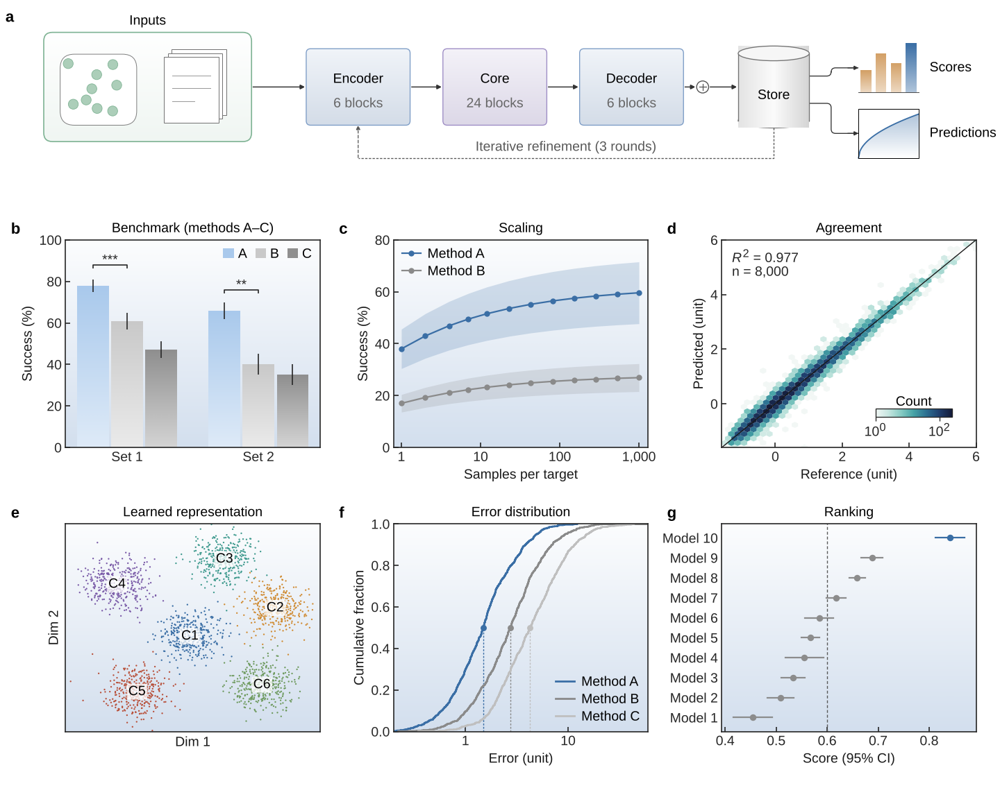

**F03 · 临床 / 生物医学主图（7 个子图）** — 研究设计、分组分布、剂量-反应、时间进程、火山图、生存曲线 + 风险人数表、亚组森林图

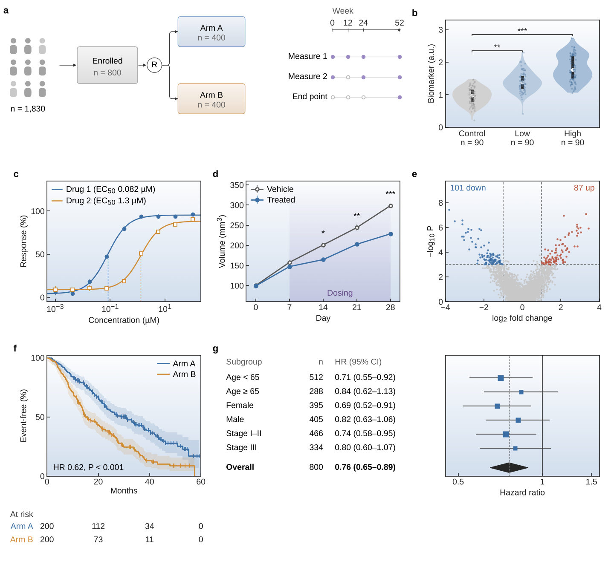

**F04 · 实验测量类主图（7 个子图）** — 装置示意、测量 vs 模型（外推）、场分布 + 显著性、重复性、原始图像、时频图、误差预算

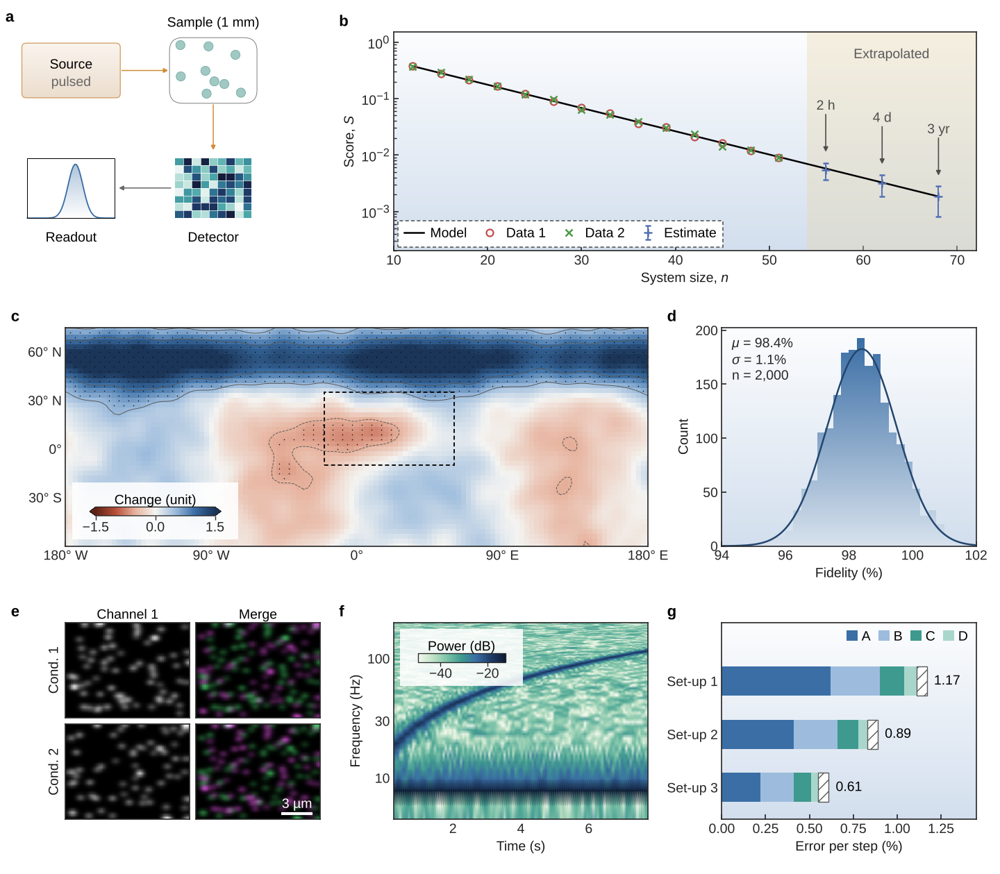

**F05 · 地球 / 气候综合主图（8 个子图）** — 变化地图、情景预测、驱动因素、组成变化、分年代分布、区域小图、风向玫瑰图、类型转移

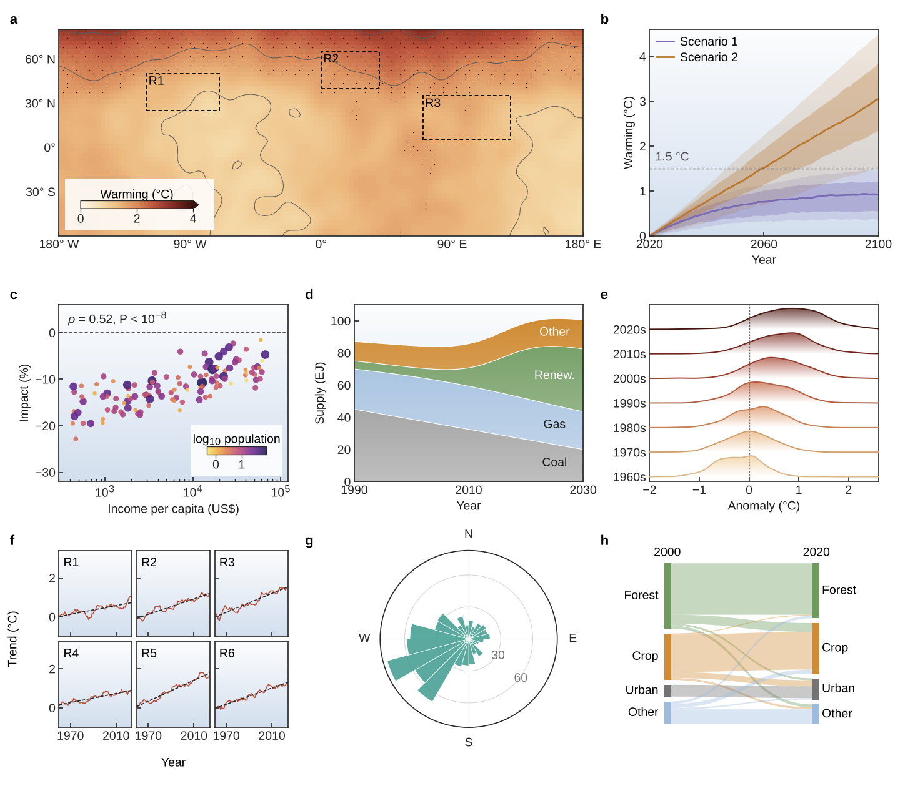

**F06 · 机器学习论文主图（10 个子图）** — 模型结构、训练、缩放律、ROC、PR、混淆矩阵、嵌入、校准、结果表、消融

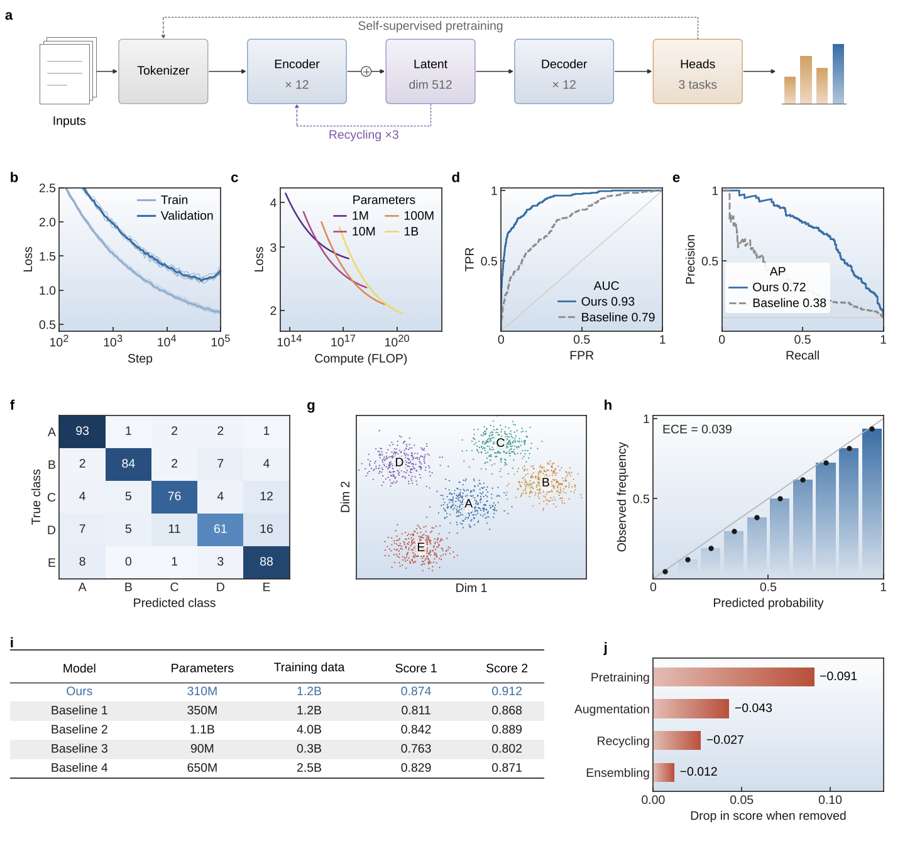

**F01 · 简洁组合页（6 个子图）**

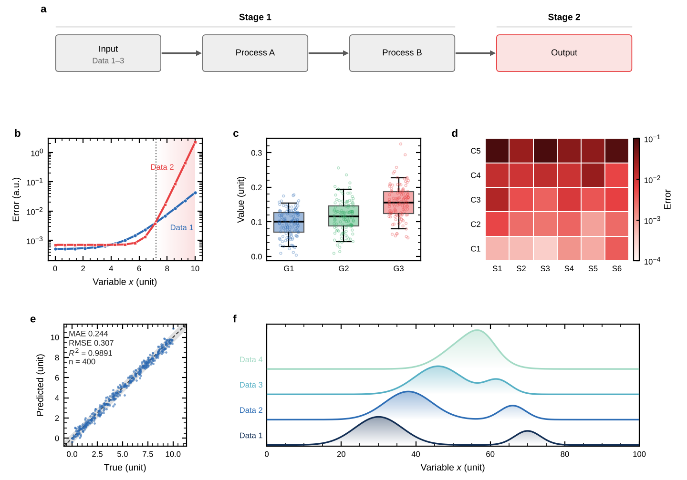

单图模板精选（共 62 个，全部见 [模板图库](skills/nature-plotting/README.md)）：

<table>
<tr>
<td>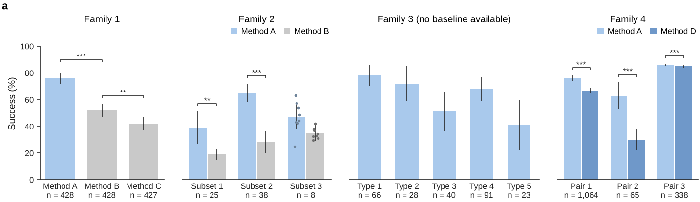<br><sub>C01 基准柱 + 显著性 + n</sub></td>
<td>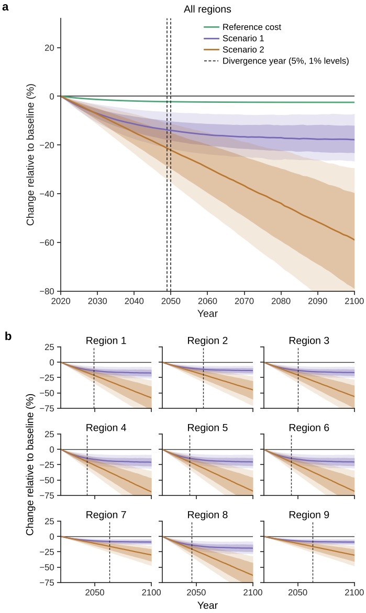<br><sub>T02 情景扇形带 + 区域小图</sub></td>
<td>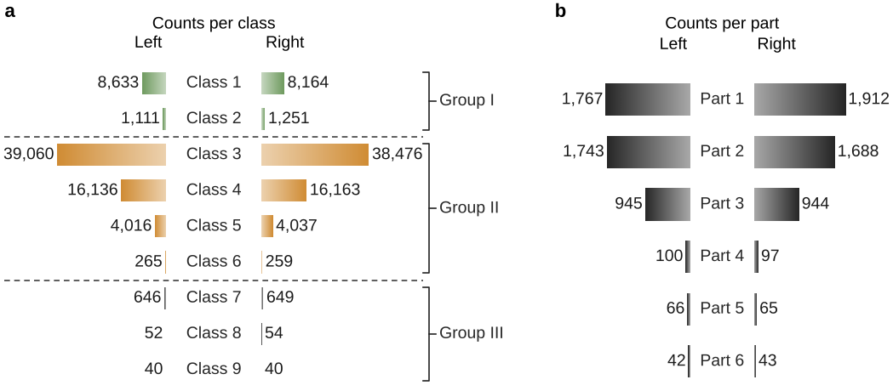<br><sub>C03 左右对称计数</sub></td>
</tr>
<tr>
<td>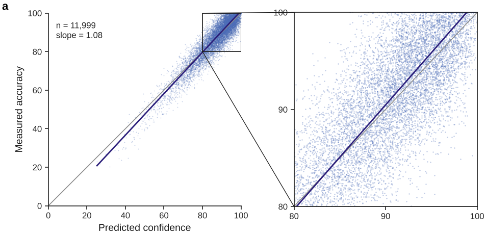<br><sub>R01 密集散点 + 放大面板</sub></td>
<td>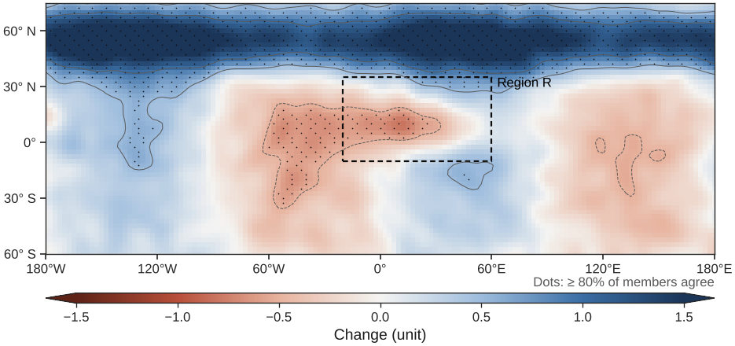<br><sub>M05 场分布 + 显著性打点</sub></td>
<td>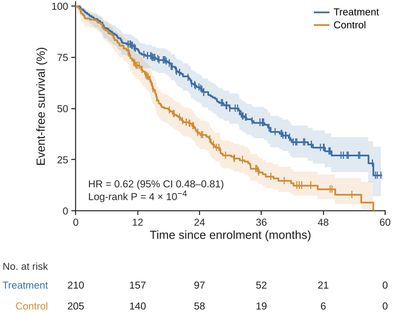<br><sub>B01 生存曲线 + 风险人数</sub></td>
</tr>
<tr>
<td>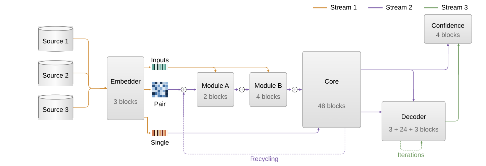<br><sub>S02 模型结构框图</sub></td>
<td>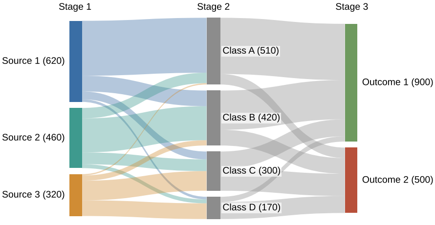<br><sub>G01 冲积图</sub></td>
<td>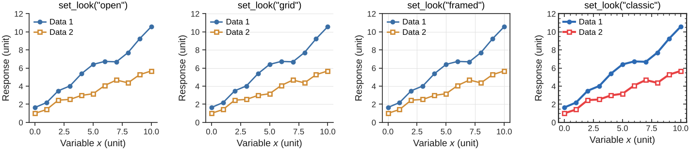<br><sub>K04 五种坐标外观</sub></td>
</tr>
</table>

## Quick install

1. `git clone https://github.com/denghuipan/nature-portfolio-skills.git`
2. Copy `config.example.yaml` → `config.yaml` (optional: set `canonical_plotting_dir`; default `""` uses bundled assets).
3. Run the installer for your OS:

**macOS / Linux**

```bash
cd nature-portfolio-skills
cp config.example.yaml config.yaml
chmod +x scripts/install.sh
./scripts/install.sh
# or: python3 scripts/install.py
```

**Windows**

```powershell
powershell -ExecutionPolicy Bypass -File scripts\install.ps1
```

4. Restart **Cursor**, **Claude Code**, and/or **Codex**.

Install copies `skills/*` into:

| Agent | macOS / Linux | Windows |
|-------|----------------|---------|
| Cursor | `~/.cursor/skills/` | `%USERPROFILE%\.cursor\skills\` |
| Claude Code | `~/.claude/skills/` | `%USERPROFILE%\.claude\skills\` |
| Codex | `~/.codex/skills/` | `%USERPROFILE%\.codex\skills\` |

Toggle agents in `config.yaml` under `agents:`.

## Use the agent to install

After the first manual copy of this repo, open any agent and say:

> 用 nature-portfolio 安装/同步 Nature skills

The **nature-portfolio** skill tells the agent to run `scripts/install.ps1`.

## What's inside `skills/`

| Skill | Role |
|-------|------|
| nature-portfolio | Install & sync (this bootstrap) |
| nature-plotting | Matplotlib house style + NP sizes (`np_final`), switchable axis looks, 62 single-panel templates + 6 full-page main figures modelled on recent Nature-family layouts, colour maps / palettes / colour bars, diagram primitives — see [gallery](skills/nature-plotting/README.md) |
| nature-figure | Figure contract, layouts, QA |
| nature-writing | Manuscript sections |
| nature-polishing | English polish |
| nature-citation | CNS-family citations |
| nature-academic-search | Literature search & bibliographies |
| nature-data | Data availability |
| nature-reviewer / nature-response | Pre-review & rebuttal |
| nature-reader | Bilingual paper reader |
| nature-paper2ppt / nature-paper-to-patent | Slides & patent draft |
| paper-figure-style | Legacy; prefer nature-plotting |

## 使用教程 / How to use with an agent

### 1. 安装（一次）

按上面的 Quick install 运行安装脚本，`skills/` 会被复制到 Cursor、Claude Code、Codex 的 skills 目录；
之后**重启 agent**。也可以在任意 agent 里说：

> 用 nature-portfolio 安装/同步 Nature skills

更新时 `git pull` 后重新运行一次安装脚本即可。

### 2. 在 agent 里画图

`nature-plotting` 的触发词写在它的 `SKILL.md` 里（画图、作图、出图、配图、科研绘图、色条、示意图、概念图、
流程图、plot、chart、figure、Nature style ……）。说出这些词时 agent 会自动加载它；也可以直接点名：
“用 nature-plotting ……”。agent 会按下面的流程工作：

1. 读 `SKILL.md`，先写清这张图要证明的一句话、每个子图的作用、尺寸（89 / 183 mm）和统计口径；
2. 在模板表里按“要回答的问题”选模板（单图 T/C/D/R/M/N/B/G/K/S，整页 F01–F06）；
3. 把模板复制到你的项目，**只替换 `MOCK DATA` 一段**为你的真实数据，其余样式代码不动；
4. 运行，打开生成的 PNG 逐个面板看：重叠、裁切、图例压数据、颜色可读性；
5. 跑检查：`export()` 会提示字号或字体不统一的文字，整页图的 `pg.check()` 会列出没对齐的框线，
   `scripts/audit_layout.py` 检查 PDF 的尺寸、字体、分辨率；
6. 改完再看一遍，交付 PNG（600 dpi）+ 可编辑 PDF。

### 3. 可以直接这样说（示例提示词）

| 你想要 | 对 agent 说 |
|---|---|
| 单个图 | 用 nature-plotting 的 C01 模板，把 `results.csv` 里三种方法在两个数据集上的成功率画成柱状图，带误差线、显著性和 n，单栏 89 mm |
| 换数据重画整页图 | 参照 F02，把我的方法流程、基准、缩放实验、预测 vs 真值、embedding、误差分布做成一张 183 mm 的主图，数据在 `data/` 里 |
| 从零排一张主图 | 帮我排一张 8 个子图的主图：a 流程示意，b–d 三个对比柱状图，e 热图，f 时间序列，g–h 两个散点；框线对齐，字号统一 |
| 选图型 | 我有每个样本在处理前后的测量值，n = 18，用什么图最好？按 nature-plotting 的选图表推荐并画出来 |
| 改样式 | 把这张图改成全框线、统一 7 pt Arial、加渐变背景；或者：去掉背景渐变，改成 L 形坐标轴 |
| 示意图 | 用 nature-plotting 的示意图元件画一个“数据 → 编码器 → 核心 → 解码器 → 输出”的流程图，带虚线循环 |
| 检查 | 检查 `Fig2.pdf` 是否符合 Nature 的图片要求（尺寸、字体、字号、分辨率），并列出要改的地方 |

小技巧：
- 说清楚**用途和尺寸**（单栏 / 双栏、最终高度），以及每个子图要表达的结论，比描述样式更有用；
- 指明数据文件和列名；统计方法（均值 ± s.e.m.、检验方法、n）一起告诉 agent；
- 想保持原论文的老样式（四边框、刻度朝内、次刻度）就说“用 classic 外观”。

### 4. 不用 agent，直接在 Python 里用

```python
import sys
sys.path.insert(0, "path/to/nature-portfolio-skills/skills/nature-plotting/assets")
from nature_style import *          # 样式、尺寸、配色（导入即生效：全框线、7 pt、渐变背景）
from nature_cmaps import *          # 色图、色条
from nature_charts import *         # 图表构件 + export()
use_arial_math()

fig, ax = plt.subplots(figsize=figsize_1col())          # 89 mm 宽
bars(ax, [0, 1, 2], [78, 61, 47], err=[3, 4, 4], colors=THEMES["soft"][:3])
ax.set_xticks([0, 1, 2], ["Method A", "Method B", "Method C"]); ax.set_ylabel("Success (%)")
export(fig, "fig1b")                                      # figure_preview/fig1b.png (600 dpi) + .pdf
```

整页主图用毫米网格：

```python
from nature_layout import Page, columns
pg = Page(183, 165)
cols = columns(12, 178.5, 3, gap=13.5)
a = pg.canvas(0, 1, 183, 30)          # 示意图带（单位 mm）
b, c, d = pg.row(44, 38, cols)        # 同一行三个框：顶边、高度一致
pg.letter(a, "a"); pg.letters([b, c, d], "bcd")
pg.save("Fig1")                       # 对齐检查 + 精确页面尺寸导出
```

常用开关：`set_look("boxed" | "grid" | "framed" | "open" | "classic")`、`set_background("none")`、
`apply_preset("preview")`（大字号预览，用于幻灯片）、`fs()`（当前统一字号）。
全部模板一次性重新出图：`python skills/nature-plotting/scripts/render_gallery.py`。

### 5. 常见问题

- **字体**：代码优先用 Arial；Windows / macOS 自带 Arial。Linux 服务器没有 Arial 时自动用字宽相同的
  Liberation Sans，排版不变。
- **字号**：所有文字统一一个字号（默认 7 pt），只有面板字母是 8 pt 粗体；不要在代码里单独写 `fontsize=`。
- **图太挤**：先换成双栏（`figsize_2col()` 或 `Page(183, …)`），再减少子图里的文字，不要把字号调小。
- **想要老样式**：`set_look("classic")`（`paper-figure-style` 技能默认就是它）。

## Maintenance

- Edit skills under **`skills/`** in this repo, then re-run `install.ps1`.
- Canonical plotting module: `skills/nature-plotting/assets/nature_style.py`
  (install can sync it to `canonical_plotting_dir`; leave that empty if your paper repo keeps its own copy).
- Figure templates: `skills/nature-plotting/templates/` (mock data), previews rebuilt with
  `python skills/nature-plotting/scripts/render_gallery.py`.

## State file

`%USERPROFILE%\.nature-portfolio\state.json` records `bundle_root` for agents.

## Publish to GitHub (this machine)

1. One-time login: `gh auth login` (browser device flow).
2. From repo root:

```powershell
powershell -ExecutionPolicy Bypass -File scripts\publish_github.ps1
```

Default: **private** repo `nature-portfolio-skills`. Pass `-Visibility public` if you want it public.

`config.yaml` is gitignored (local paths). Only `config.example.yaml` is tracked.

## Backups

Legacy pre-`np_final` matplotlib module: `backups/nature_style.pre_np_final_backup.py`.

## License

Personal academic workflow; individual skill files may carry their own attribution.
