# nature-plotting 模板库

Nature 系列期刊风格的 matplotlib 绘图模板，共 62 个。版式参考了大量近年 Nature、Nature Methods、
Nature Communications、Nature Climate Change 等论文中反复出现的图形做法（开放坐标轴、外向短刻度、柔和配色、
显著性括号与 n、千分位数字、虚线图例框、情景扇形带、蝴蝶图、表格图、流程框图等），全部重新绘制，
不复制任何已发表的图。图中数据都是虚拟的（Data 1、Group A、Method B……），换成自己的数据即可。

## 用法

```bash
python templates/C01_bars_significance.py     # 运行单个模板，输出到 ./figure_preview/（PNG 600 dpi + PDF）
python scripts/render_gallery.py              # 重新生成本页全部预览图
python scripts/audit_layout.py fig.pdf        # 检查 PDF：尺寸、字体、字号、面板字母、对齐、分辨率
```

1. 按要回答的问题选模板（见下表或 `references/chart-chooser.md`）。
2. 复制模板，只替换 `MOCK DATA` 这一段数据，其余保持不变。
3. 运行，打开 PNG 逐个面板检查，再跑 `audit_layout.py`。

模块：`assets/nature_style.py`（样式、坐标外观、尺寸、导出）、`assets/nature_charts.py`（图表构件）、
`assets/nature_cmaps.py`（色图、配色、色条）、`assets/nature_schematic.py`（示意图元件）。

规范：单栏 89 mm，双栏 183 mm，高度 ≤ 170 mm。默认样式：全部文字 Arial、统一 7 pt（仅面板字母 8 pt 粗体）；
每个数据面板全框线、短刻度朝内（下、左）、无次刻度；保存时自动给面板加柔和的竖向渐变背景；柱状图、直方图、
曲线下面积、时间窗、堆叠面积、示意图方框等默认渐变填充。`set_look("grid" | "framed" | "open" | "classic")`
可切换外观（见 K04），`set_background("none")` 关闭背景渐变。避免彩虹色图和单纯红绿对比。
详见 `references/nature-rules.md`。


## 趋势与时间序列

| **T01_marker_decay_log**<br>空心 o / × / + 标记 vs 模型线（对数轴），虚线框图例与插图，外推区箭头标注代价 | **T02_scenario_fans**<br>情景扇形图：中位线 + 两层不确定带，分歧年份虚线；下方 3×3 区域小图共享坐标 |
|---|---|
| 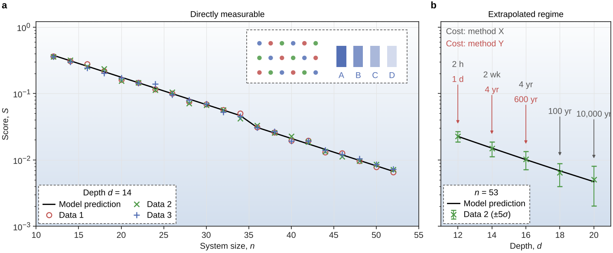 | 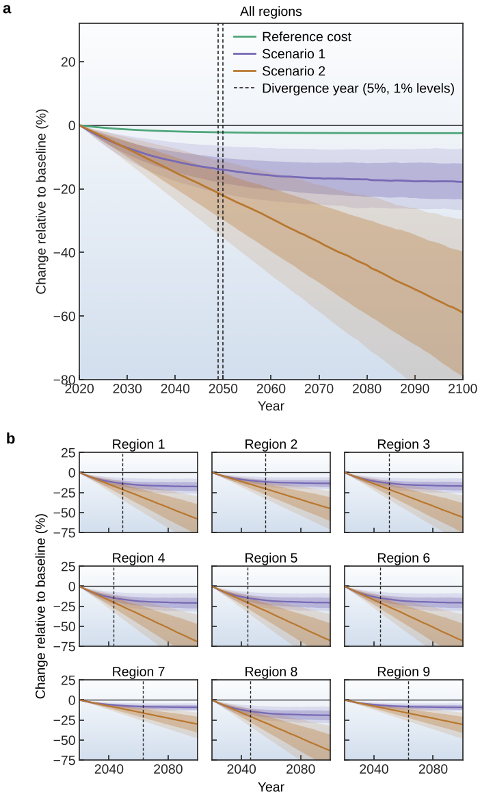 |

| **T03_scaling_bands**<br>成功率随样本量（对数 x）：两方法点线 + 置信带，右侧竖向显著性括号 | **T04_growth_bars**<br>随时间增长的窄柱，同色系深浅区分来源，千分位逗号 |
|---|---|
| 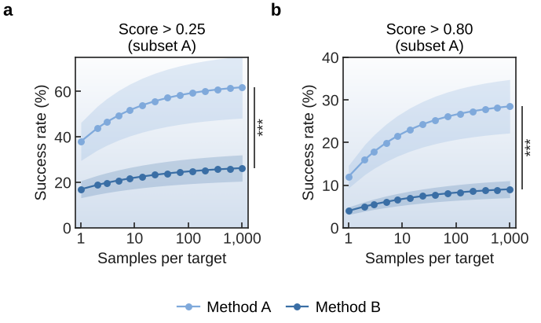 | 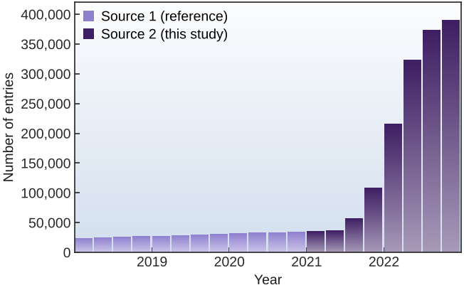 |

| **T05_slopegraph**<br>斜率图：两时间点配对连线，突出上升 / 下降项，其余灰色 | **T06_stacked_area**<br>堆叠面积（层内直接标注）+ 占比折线（末端标签自动避让） |
|---|---|
| 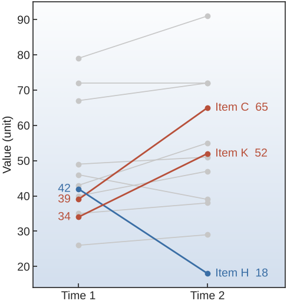 | 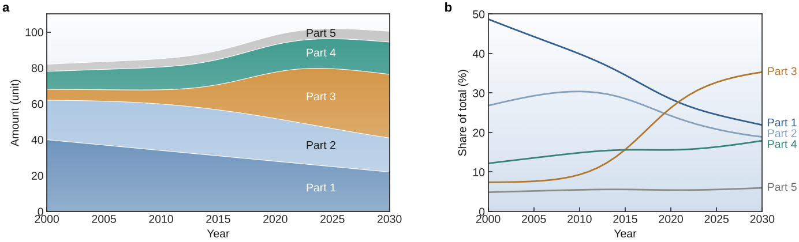 |

| **T07_events_timeseries**<br>长时间序列：原始值浅线 + 滑动均值，阴影时间窗，顶部事件标注（grid 外观） | **T08_trace_state_raster**<br>连续信号 + 事件栅格 + 状态色带，共享时间轴，比例尺代替坐标轴 |
|---|---|
| 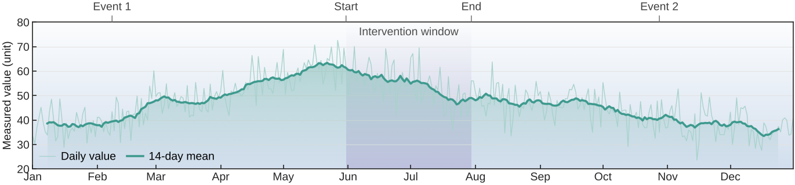 | 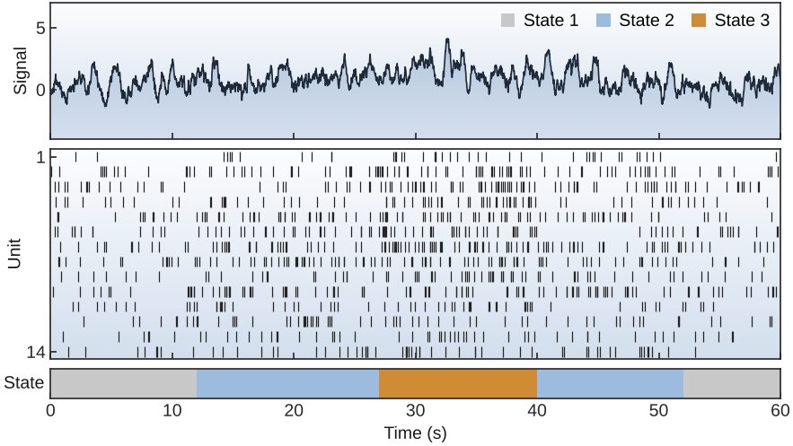 |


## 比较

| **C01_bars_significance**<br>分组基准柱：浅色主方法 + 灰色基线，误差线、显著性括号、类目下方 n | **C02_overlay_bars**<br>叠加柱：子集画在总量之内，对数与线性两种坐标 |
|---|---|
| 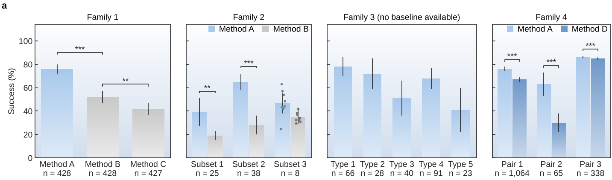 | 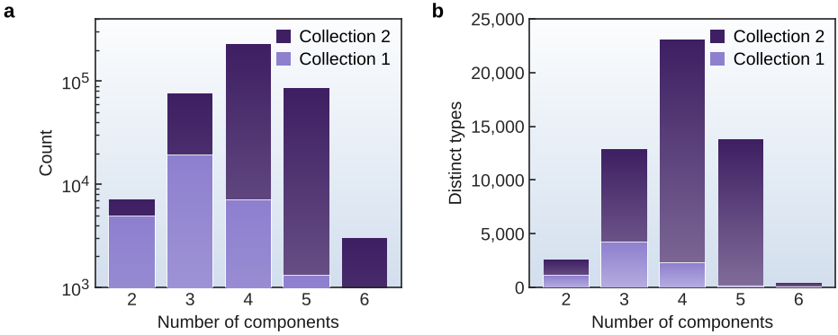 |

| **C03_butterfly_counts**<br>蝴蝶图：左右对称计数，中列标签，虚线分组 + 侧边方括号组名 | **C04_error_budget**<br>误差预算：水平堆叠条，未解释部分斜线填充，实测总量点 |
|---|---|
| 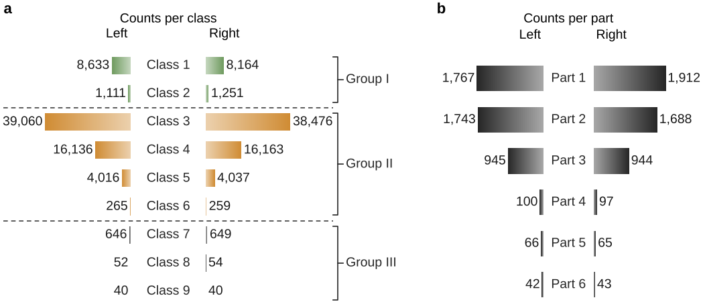 | 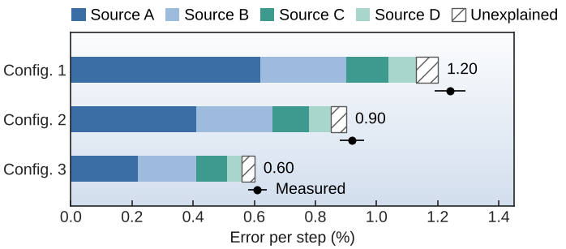 |

| **C05_dot_ranking**<br>Cleveland 点图排名：区间线 + 参考值，重点条目着色 | **C06_forest_table**<br>森林图 + 数值表：权重方块、合并菱形、零效应线、有利方向标注 |
|---|---|
| 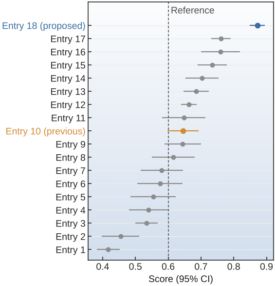 | 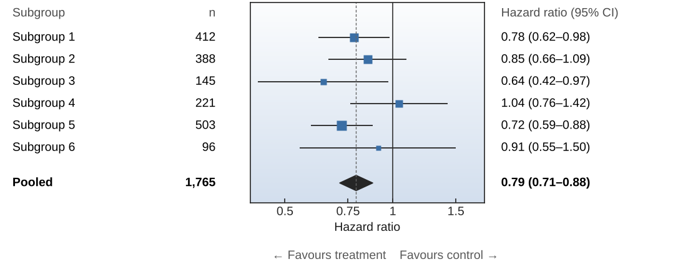 |

| **C07_table_scatter**<br>表格图（斑马纹、双线分组、改进值着色）+ 黑边高亮标注散点 | **C08_part_of_whole**<br>部分与整体：环形图、100% 堆叠条、华夫图，同色同义 |
|---|---|
| 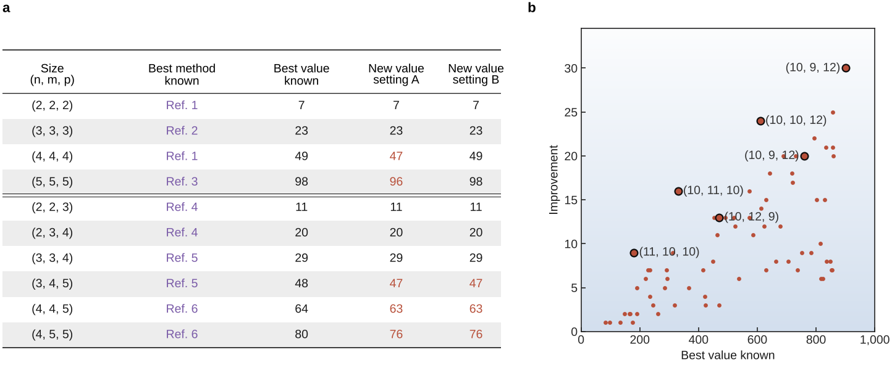 | 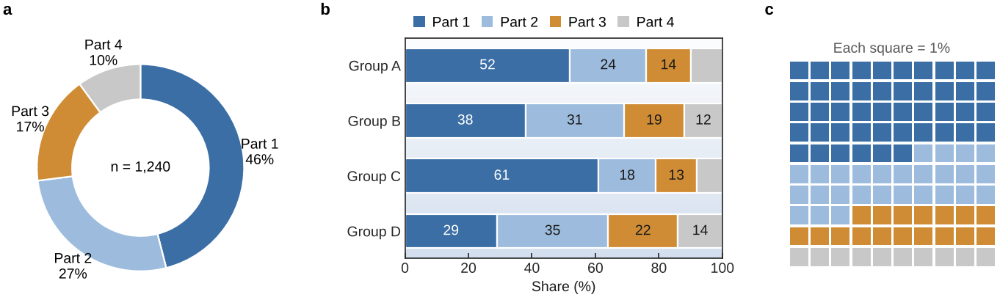 |

| **C09_horizontal_pairs**<br>长类目名的水平配对条形 + 百分比轴 | **C10_dumbbell_change**<br>哑铃图：两条件数值，按变化量排序，增减着色，右侧写 Δ |
|---|---|
| 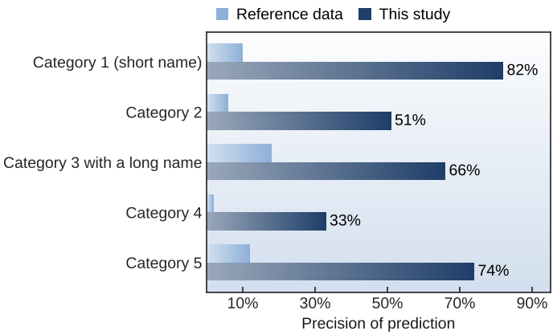 | 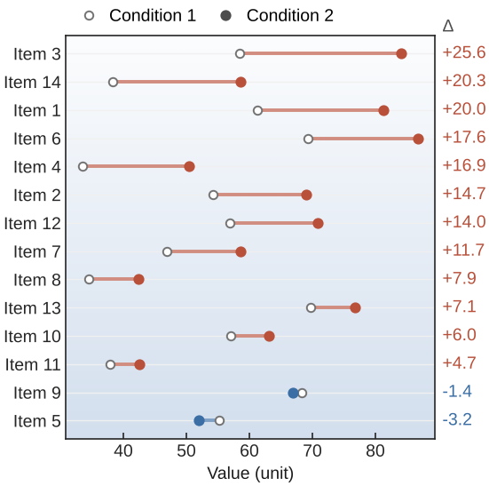 |


## 分布

| **D01_violin_box**<br>小提琴 + 内嵌箱线 + 全部数据点，精确 P 值括号，类目下方 n | **D02_hist_fit**<br>直方图 + 拟合曲线与参数；对数计数轴上的双组分拟合 |
|---|---|
| 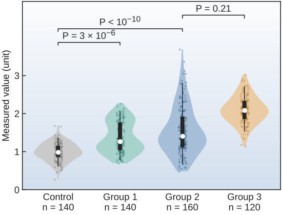 | 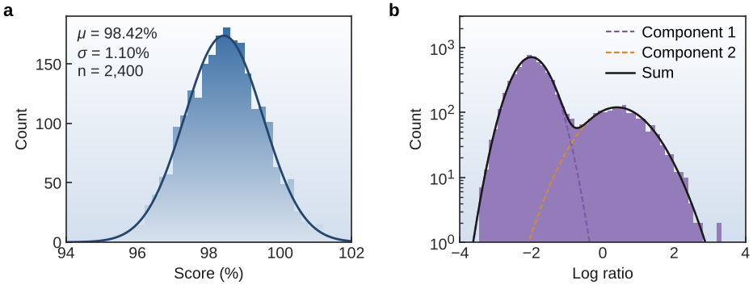 |

| **D03_step_hist_log**<br>两个数量级差异很大的群体：阶梯直方图（对数计数）+ 阈值线 | **D04_ecdf_quantiles**<br>经验累积分布 + 中位数落线；分位数点线（10/50/90%） |
|---|---|
| 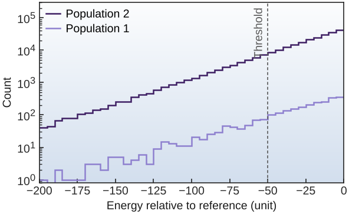 | 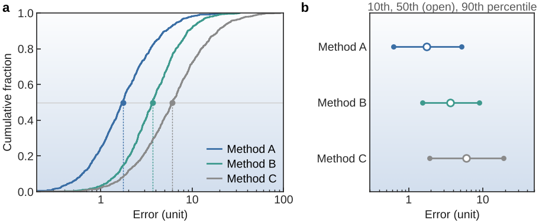 |

| **D05_ridgeline_outline**<br>山脊图：顺序色、白底遮挡、中位数短线 | **D06_beeswarm**<br>蜂群图：每个观测可见，中位数横线 + IQR 竖线（对数轴） |
|---|---|
| 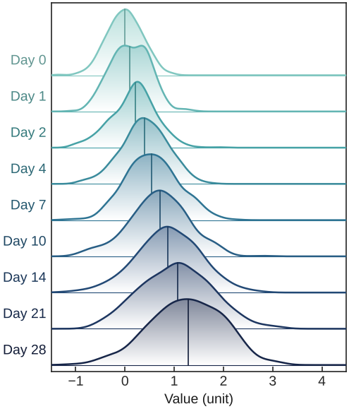 | 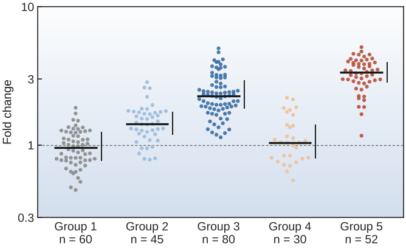 |

| **D07_paired_points**<br>配对数据：连线 + 均值±s.e.m.；差值蜂群 + 95% CI | **D08_density_contours**<br>二维密度等高线（25/50/75/95% 质量）+ 抽样散点 + 边缘密度 |
|---|---|
| 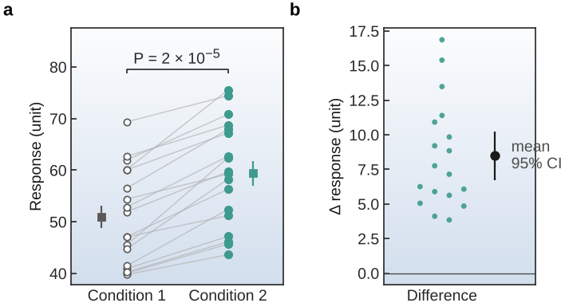 | 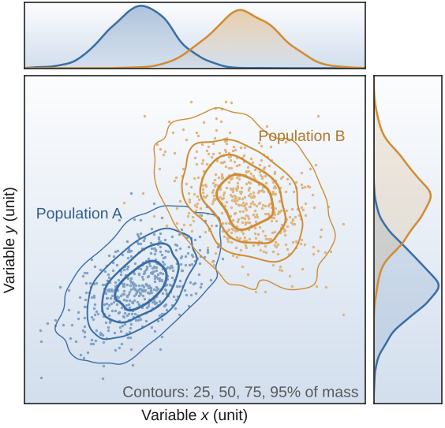 |


## 关系

| **R01_dense_scatter_zoom**<br>密集散点 + y = x + 回归线，右侧放大面板并用连线指向放大区域 | **R02_binned_trend**<br>分箱均值 ± s.e.m. 趋势 + 下方每箱样本数条带 |
|---|---|
| 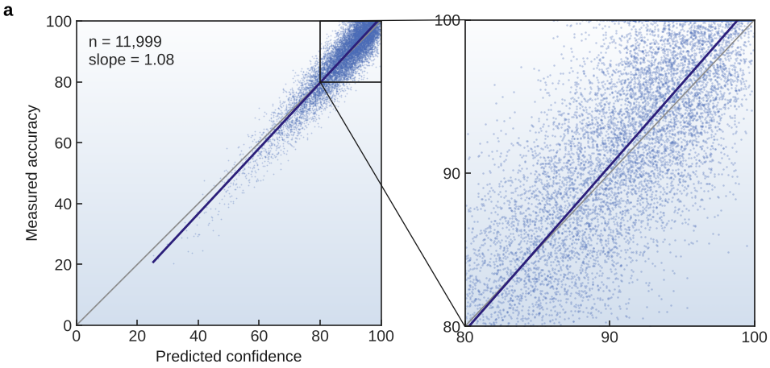 | 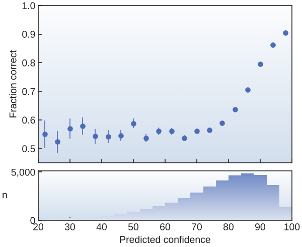 |

| **R03_bubble_colorbar**<br>气泡散点：大小 = 权重，颜色 = 第三变量，色条在下方，ρ 与 P 写在角上 | **R04_volcano**<br>火山图：上 / 下调着色、虚线阈值、显著项自动避让标注、计数 |
|---|---|
| 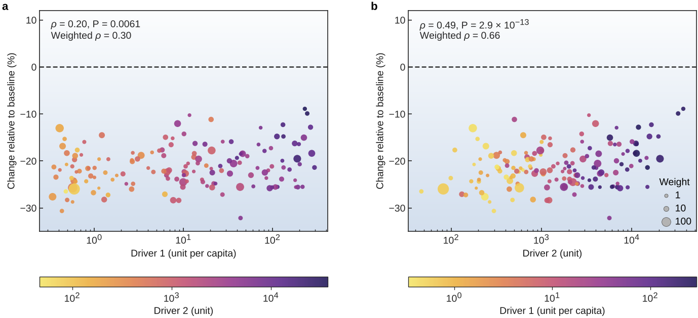 | 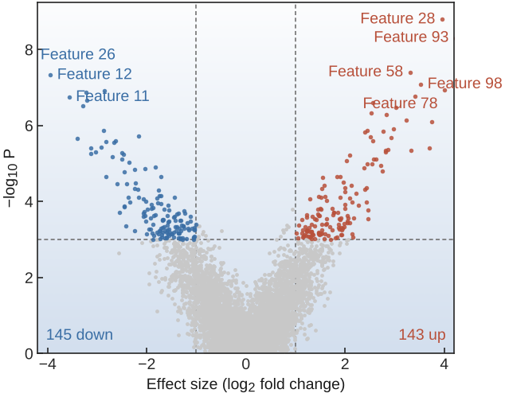 |

| **R05_embedding_clusters**<br>二维嵌入（UMAP 等）：簇名写在簇中心，角落箭头坐标；连续变量着色 + 内嵌色条 | **R06_parity_density**<br>预测 vs 参考：六边形密度（对数）、±容差虚线、误差直方图插图 |
|---|---|
| 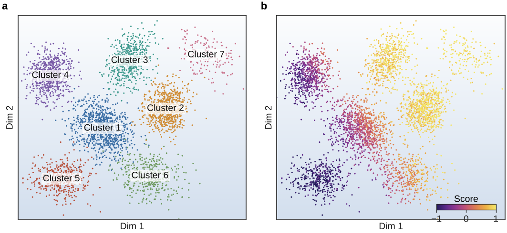 | 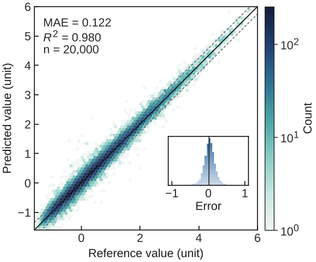 |

| **R07_group_regression**<br>分组回归：形状 + 颜色区分组，95% CI 带，线端写斜率 | **R08_quadrant_map**<br>象限图：参考线划分四区，目标区浅色，角落区名，引线标注 |
|---|---|
| 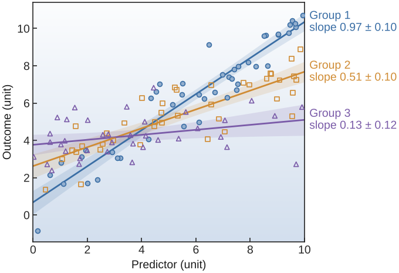 | 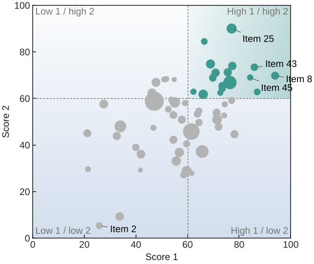 |


## 矩阵、场与图像

| **M01_dot_matrix**<br>点矩阵：点面积 = 比例，颜色 = 平均水平，特征组括号，大小图例 | **M02_cluster_heatmap**<br>聚类热图：列树状图、行分组色条、发散色图、短色条 |
|---|---|
| 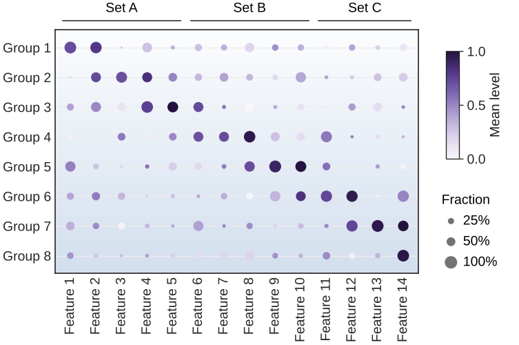 | 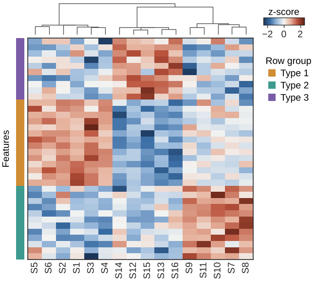 |

| **M03_corr_circles**<br>相关矩阵：下三角圆（大小与颜色 = r），上三角数值（显著加粗） | **M04_confusion_support**<br>混淆矩阵（行归一化 %）+ 右侧各类样本数条形 |
|---|---|
| 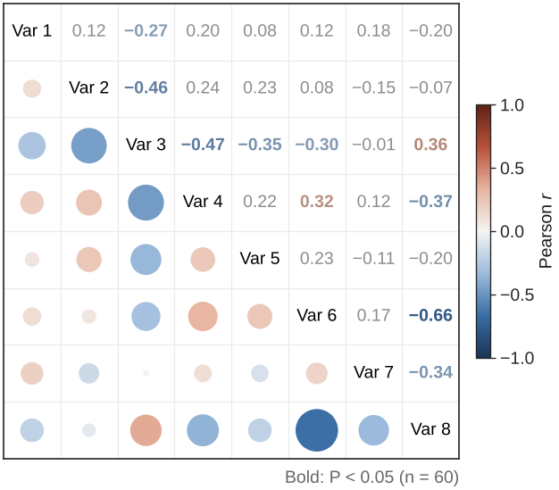 | 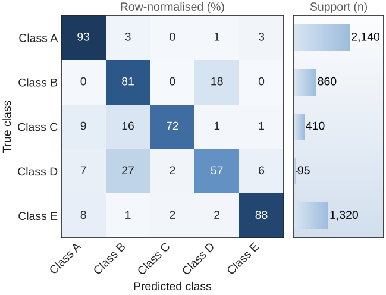 |

| **M05_field_stipple**<br>格点场：发散色 + 等值线 + 显著性打点 + 区域虚线框 + 下方色条 | **M06_image_grid**<br>图像网格：条件 × 通道 + 绿 / 品红合成 + 局部放大 + 比例尺 |
|---|---|
| 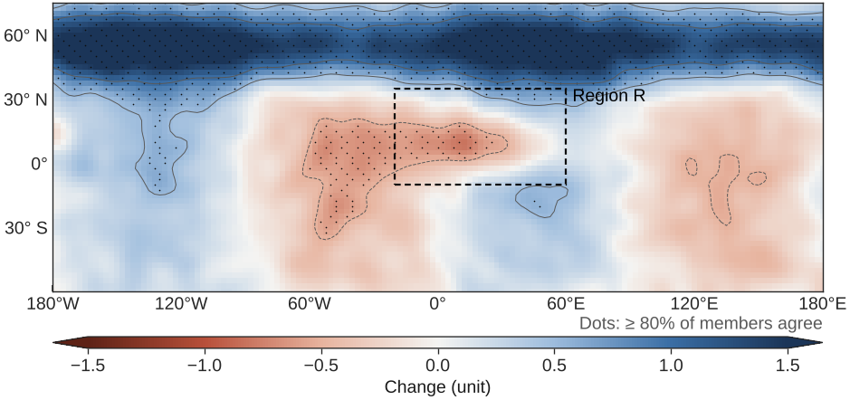 | 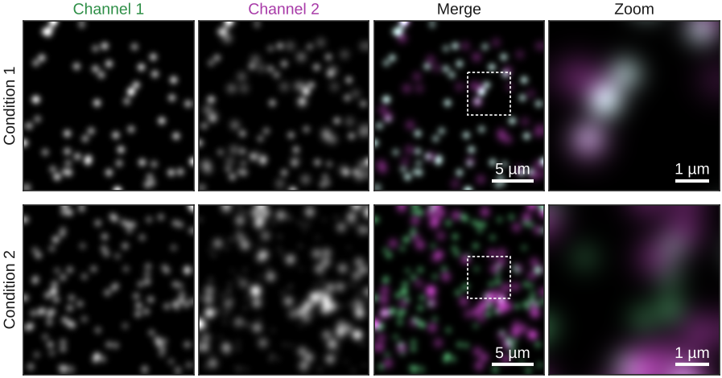 |

| **M07_polar_rose**<br>极坐标玫瑰图：方向分布 + 平均合成向量，R 与 Rayleigh P | **M08_spectrogram**<br>时频图：原始信号 + 对数频率谱图 + dB 色条 + 事件线 |
|---|---|
| 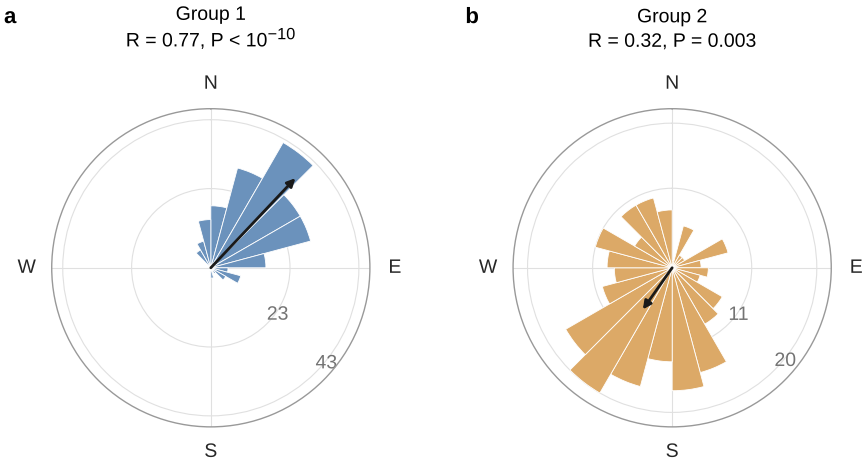 | 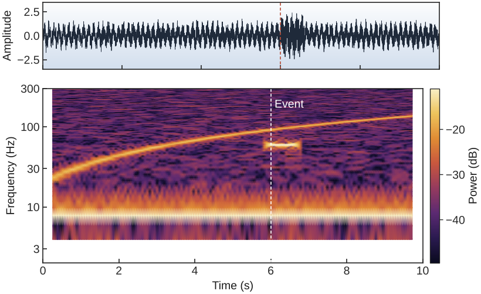 |


## 机器学习

| **N01_training_curves**<br>训练曲线：每个种子细线 + 均值粗线，最佳步标注 | **N02_roc_pr**<br>ROC 与 PR：AUC / AP 写在图例，工作点圆点，机会线 |
|---|---|
|  |  |

| **N03_scaling_law**<br>缩放律：不同规模模型的损失-算力曲线 + 前沿幂律拟合 + 离散色条 | **N04_calibration**<br>可靠性图：观测频率 vs 预测概率，间隙柱 + 样本数条带，ECE |
|---|---|
| 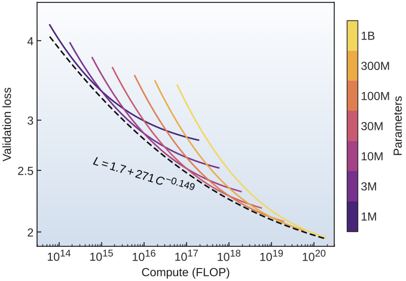 | 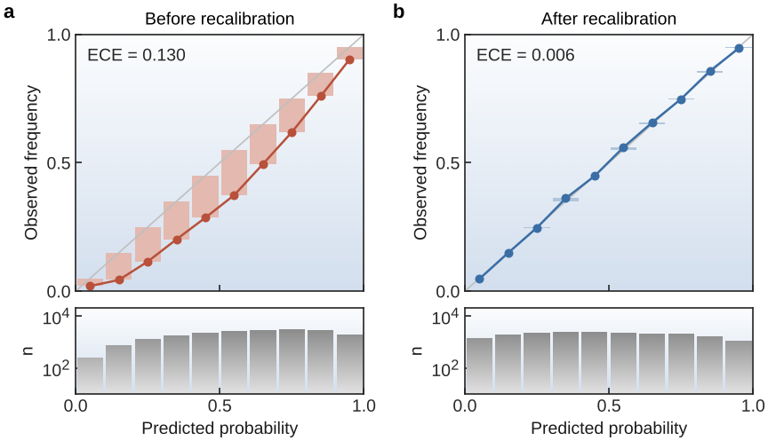 |


## 生物医学

| **B01_survival_km**<br>Kaplan–Meier：CI 带、删失刻度、HR 与 log-rank P、风险人数表 | **B02_dose_response**<br>剂量-反应：均值 ± s.e.m.、四参数 logistic 拟合、EC50 落线 |
|---|---|
| 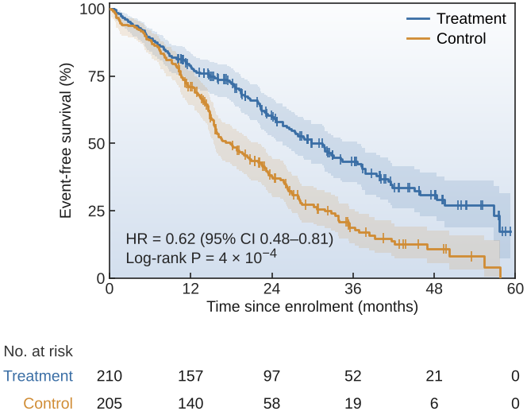 | 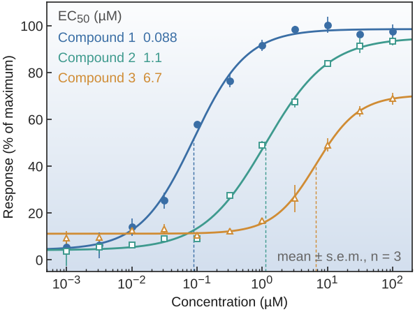 |

**B03_timecourse_stars** — 时间进程：两组均值 ± s.e.m.，处理时间窗，逐时间点星号；AUC 柱 + 点

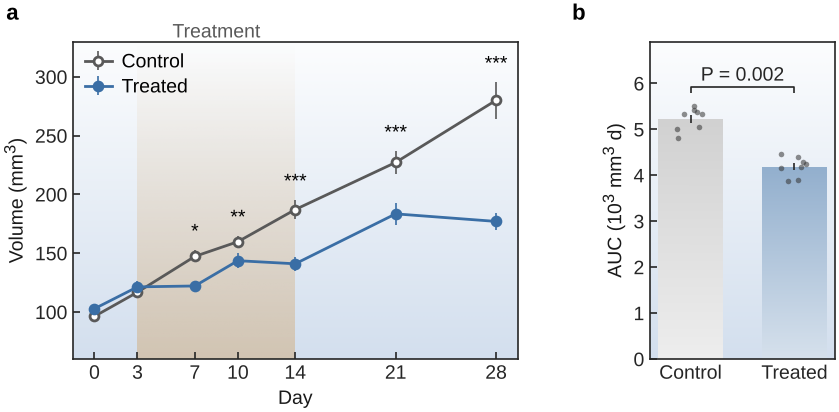


## 流向与网络

| **G01_alluvial**<br>冲积图：三阶段间的流向，节点高度 ∝ 数量 | **G02_node_link**<br>节点-连线网络：节点大小、边宽（对数）图例、角色分组括号 |
|---|---|
| 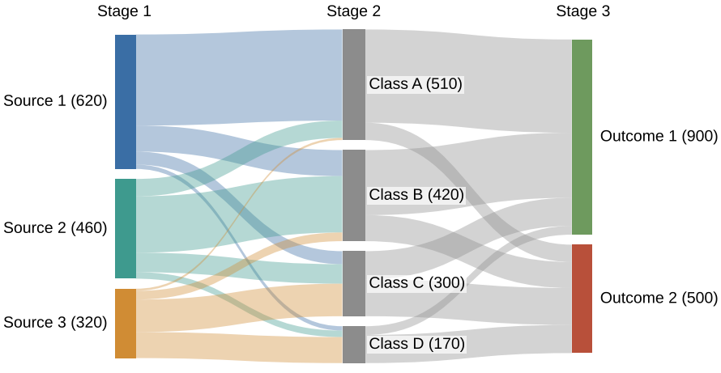 | 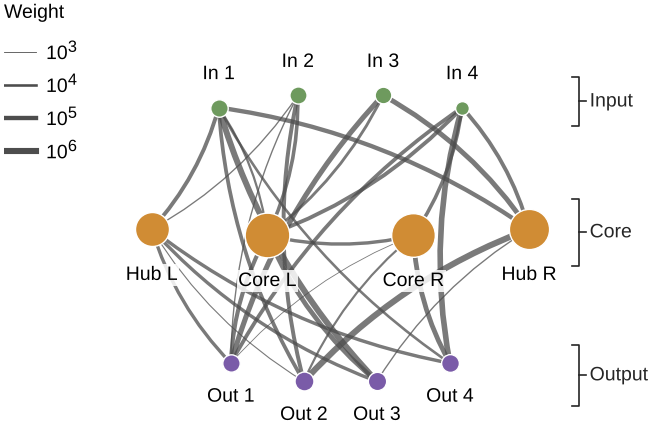 |


## 色图、色条、配色与坐标外观

| **K01_colormaps**<br>全部内置色图及其 CIE L* 亮度曲线（顺序 / 发散 / 循环） | **K02_colorbar_styles**<br>六种色条布局：侧边、内嵌、下方、分箱、类别、发散 + extend |
|---|---|
| 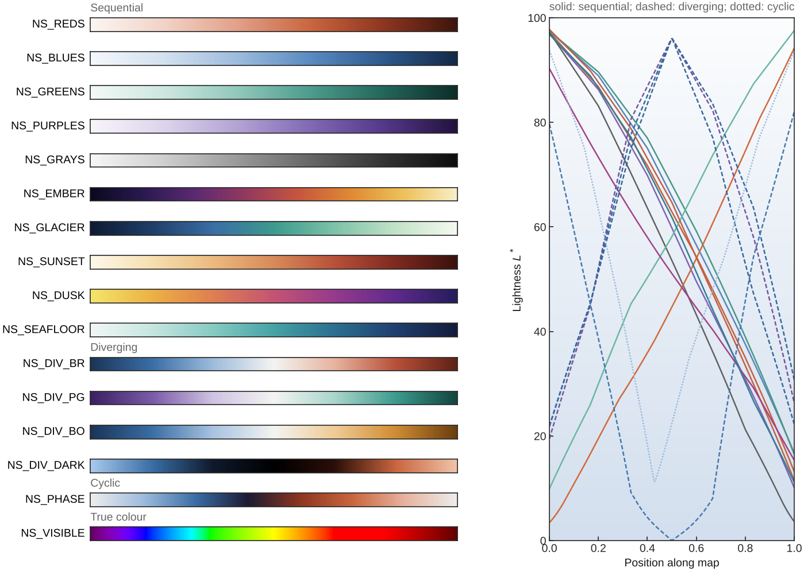 |  |

| **K03_palettes_cvd**<br>分类配色在正常视觉与三种色觉缺陷下的样子 | **K04_axis_looks**<br>同一面板的五种坐标外观：boxed（默认，全框线 + 渐变背景）、grid、framed、open、classic |
|---|---|
|  |  |


## 示意图

| **S01_pipeline_loop**<br>流程总览：两条并行分支（彩色圆角框）、评估、数据库、输出、虚线循环 | **S02_architecture**<br>模型结构框图：输入数据库、带块数的模块、三色数据流、⊕ 汇合、虚线循环 |
|---|---|
|  |  |

| **S03_cycle_stages**<br>迭代环 + 同一流程的箭头阶段与小图标 | **S04_study_design**<br>研究设计：入组人数、随机分组、访视时间轴与各项测量 |
|---|---|
|  |  |

| **S05_concept_sketches**<br>定性示意：两种标度及交叉、双势阱能量曲线、三集合交集计数 | **S06_icon_workflow**<br>图形摘要式工作流：样本 → 测量 → 数据矩阵 → 模型 → 预测 |
|---|---|
|  |  |


## 组合图

**F01_composite_figure** — 完整双栏组合页（183 × 150 mm）：流程图 + 五个数据面板


